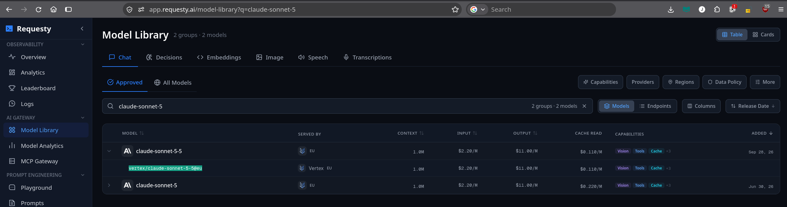
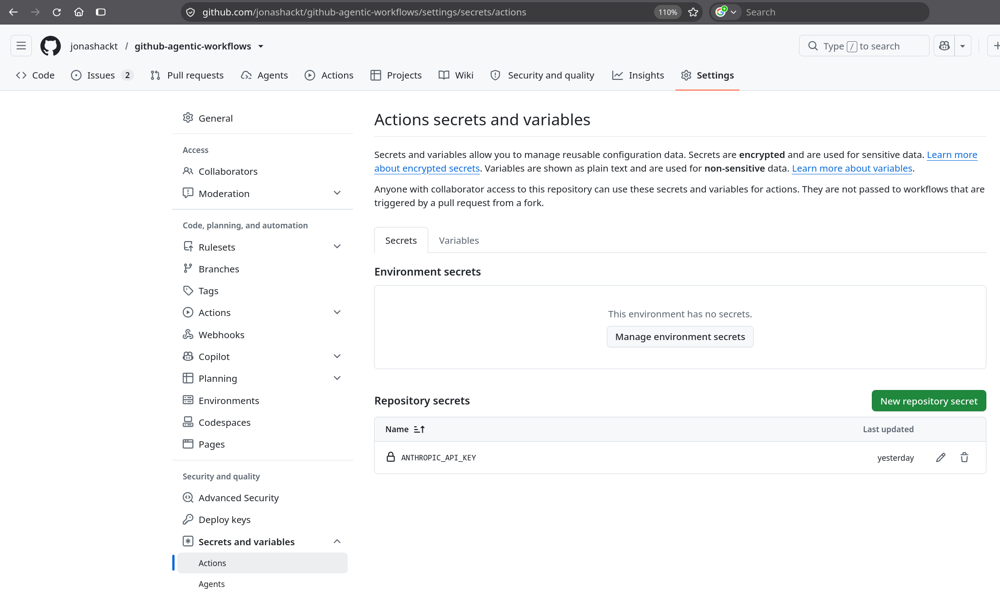
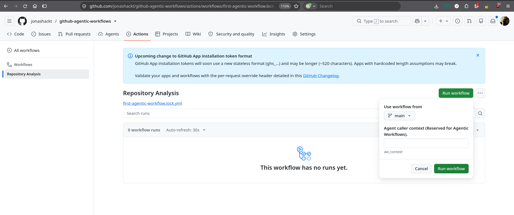

# github-agentic-workflows
Example project showing how to use GitHub Agentic Workflows to manage your repos automagically


# Why Agentic Workflows?

When I started my career I devoted a lot of time to creating public GitHub repositories - mostly as a start for writing about certain technologies and learning things myself. This got me into a situation, where my account held more then 100 repos - and taking care became impossible.

Sure I had my toolbelt setup: GitHub Actions workflows are a must - incl. a running Renovate to keep things up-to-date for me. But also with that keeping up with breaking changes in all sorts of tools, frameworks, and even GitHub Actions pipelines itself got out of hand. And saw myself focussing on only the few repositories using technologies I was currently interested in - and leaving the rest for good. 

With the advent of AI agents one question was stuck in the back of my head: Wouldn't it be nice to have AI manage my Renovate PRs, check for changes and generally maintain my repositories. Ideally also proposing changes for new framework-versions and overall optimization of my repositories?

Beeing busy with so many other things it seemed that I needed my time until I finally looked into the topic. And the little "Agents" tab already suggested a solution for some time now: There are [GitHub Agentic Workflows](https://github.github.com/gh-aw/) availalbe for exaclty my use case, which [just got generally available in Oct 2026](https://github.blog/changelog/2026-10-28-github-agentic-workflows-generally-available/). Time to have a look!


# GitHub integrated Agents into their Actions CI/CD workflows!

What's really nice about Agentic workflows: Their are simply integrated into GitHub Actions, no new tool invented here! As I love GitHub Actions [for many reasons](https://www.codecentric.de/en/knowledge-hub/blog/github-actions-nextgen-cicd) that was great news for me. 

Actions were simply enhanced using a ["frontmatter" syntax](https://github.github.com/gh-aw/reference/frontmatter/) which simply means using a configuration section between `---` markers directly your Actions workflow YAML files.

There are many ways to create your first GitHub Agentic Workflow: e.g. through [the GitHub web interface](https://github.github.com/gh-aw/setup/creating-workflows/#create-a-new-workflow-with-the-github-web-interface), using [your coding agent of choice](https://github.github.com/gh-aw/setup/creating-workflows/#create-a-new-workflow-with-a-coding-agent-or-vs-code) - or even start [setting things up manually](https://github.github.com/gh-aw/setup/creating-workflows/#create-a-new-workflow-manually), which I prefer to use for this post, since I wanted to have a more in-depth look about whats going on.


# Prepare GitHub workflow dir & install gh CLI aw extension

If you already worked with GitHub Actions, you're already used to creating workflows. Nothing new here:

```shell
# create .github/workflows/ directory
mkdir -p .github/workflows

# create a GitHub Actions workflow file
touch .github/workflows/first-agentic-workflow.md
```

Be sure to the [GitHub CLI installed](https://cli.github.com/) and install the Agentic Workflow extension:

```shell
gh extension install github/gh-aw
```

Now we should [setup our preferred AI engine](https://github.github.com/gh-aw/reference/engines/) in our workflow. 


# Setup your preferred AI engine: Claude through requesty.ai

There are [build-in AI engines](https://github.github.com/gh-aw/reference/engines/) available for GitHub Agentic Workflows like GitHub Copilot (which is obviously the default), Claude Code & OpenAI Codex. And there is the possibility to use [custom AI engines](https://github.github.com/gh-aw/reference/third-party-agent/) including OpenCode, Cursor, DeepSeek Harness among others.

As a regular Claude user, you may simply use `ANTHROPIC_API_KEY` [as documented in the build-in docs](https://github.github.com/gh-aw/engines/claude/) - and you're good to go.

But if you're using a unified AI gateway/LLM router (featuring multiple models) like [requesty.ai](https://www.requesty.ai/), you need to be able to configure a different `ANTHROPIC_BASE_URL` also, which isn't documented in the same area of the AI engine docs. But luckily in the reference docs at the [GitHub Actions secrets for AI engines](https://github.github.com/gh-aw/reference/auth/?#github-actions-secrets-for-ai-engines) paragraph there's the `Custom endpoints` section [for the ANTHROPIC_API_KEY](https://github.github.com/gh-aw/reference/auth/?#anthropic_api_key):

> To route Claude through a custom Anthropic-compatible endpoint (e.g., an internal proxy or Azure-hosted model), set ANTHROPIC_BASE_URL in engine.env and store any additional credentials as secrets.

So using requesty.ai needs the following `engine.env` variables in our workflow file [.github/workflows/first-agentic-workflow.md](.github/workflows/first-agentic-workflow.md):

```yaml
engine:
  id: claude
  env:
    ANTHROPIC_BASE_URL: https://router.eu.requesty.ai
    ANTHROPIC_MODEL: vertex/claude-sonnet-5-5@eu[1m]

network:
  allowed:
    - defaults
    - router.eu.requesty.ai #TODO: is this needed for requesty?
```

Staring at the last line you may already spotted that we need to configure `router.eu.requesty.ai` [as an allowed network via the `network.allowed` keyword](https://github.github.com/gh-aw/reference/engines/?#custom-api-endpoints-via-environment-variables). This is needed, since the Agent Workflow Firewall (AWF) would otherwise block the request to requesty.


You should also choose an approved model from the requesty model-library to configure in the `ANTHROPIC_MODEL` variable. You may find those via the direct link https://app.requesty.ai/model-library. A correct configuration for our requesty instance is:

```shell 
ANTHROPIC_MODEL: vertex/claude-sonnet-5-5@eu[1m]
```

See also our console:



If you define a default Anthropic model name like `anthropic/claude-sonnet-5-5`, you may run into GitHub Actions errors like:

```shell
"content":[{"type":"text","text":"Failed to authenticate. API Error: 403 The requested model is not approved for this API key. An org or group admin can approve it in the Model Library (https://app.requesty.ai/model-library) or add it to the access list attached to this key or group"}]
```


As [the Requesty documentation states](https://www.requesty.ai/blog/claude-code-environment-variables-anthropic-base-url-auth-token), we should use `ANTHROPIC_AUTH_TOKEN` instead of `ANTHROPIC_API_KEY` when configuring a different LLM gateway than Anthropic.

So I was tempted to use `engine.env.ANTHROPIC_AUTH_TOKEN: ${{ secrets.REQUESTY_API_KEY }}` as a configuration here also. Later on this lead me to an error:

```shell
gh aw compile
✗ Compiled 1 workflow: 0 succeeded, 1 failed, 1 error, 0 warnings

✗ Failed workflows:
✗ first-agentic-workflow.md

✗ first-agentic-workflow.md (1 error(s)):
  • 🟡 MEDIUM PRIORITY:
  • 1. .github/workflows/first-agentic-workflow.md:8:1: error: strict mode: secrets detected in 'engine.env' section are excluded from the agent sandbox via awf --exclude-env (requires AWF v0.25.3+) and are not accessible to the agent when that version is in use. Found: ${{ secrets.REQUESTY_API_KEY }}. Use engine-specific secret configuration instead. See: https://github.github.com/gh-aw/reference/engines/
 5 | permissions:
 6 |   contents: read
 7 |
 8 | engine:
     ^^^^^^
 9 |   id: claude
10 |   env:
11 |     ANTHROPIC_BASE_URL: https://router.eu.requesty.ai
i → Adjust the permissions block to match the workflow's required scopes.
✗ compilation failed
```

The reason is that the Agent Workflow Firewall (AWF) [blocks the usage of such secrets](https://github.github.com/gh-aw/reference/frontmatter/#environment-variables-env) directly in the `env` section in Actions workflow:

> CAUTION: Do not use ${{ secrets.* }} expressions in the workflow-level env: section. Environment variables defined here are passed directly to the agent container, which means secret values would be visible to the AI model. In strict mode, this is a compilation error. In non-strict mode, it emits a warning.

> Use engine-specific secret configuration instead of the env: section to pass secrets securely.

This prevents secrets from beeing injected into workflows - and thus from potential leaks. Which might also be the good reason to have the scrict mode turned on in `gh aw compile`.

So let's try to use the `ANTHROPIC_API_KEY` GitHub Actions secret instead. You can create the Secret using the `gh aw` CLI like this:

```shell
gh aw secrets set ANTHROPIC_API_KEY --value "REQUESTY_API_KEY"
```

or using the GitHub UI:

//TODO: change Secrets name



Since this is a Agent Workflows build-in engine key, we don't need to define it inside our workflow anywhere.


# Create & compile your first GitHub Agentic Workflow file

With that knowledge at hand let's craft our first Agentic-boosted GitHub Actions workflow - featuring Claude as our AI engine, which the GitHub Agentic Workflows engine consumes through requesty.ai. Our [.github/workflows/first-agentic-workflow.md](.github/workflows/first-agentic-workflow.md) may look like this:

```yaml

---
on:
  workflow_dispatch:

permissions:
  contents: read

engine:
  id: claude
  env:
    ANTHROPIC_BASE_URL: https://router.eu.requesty.ai
    ANTHROPIC_MODEL: anthropic/claude-sonnet-5-5

network:
  allowed:
    - defaults
    - router.eu.requesty.ai
---

# Repository Analysis

Analyze the repository and identify potential
improvements to its build and CI/CD configuration.

Provide a prioritized summary.
```

But be aware that __this is only a description of the Actions workflow, we want the GitHub Agentic AI engine to generate for us__. [The GitHub Agentic Workflows docs intro](https://github.github.com/gh-aw/introduction/overview/#coding-agents-running-with-tools-in-github-actions) has a good explanation ready for us:  

> Instead of writing intricate scripts to handle issue triage, code reviews, or release management, you describe what you want to happen. The AI agent uses the repository context, tools, and permissions that the workflow allows to interpret the situation and request appropriate actions.

So with GitHub Agentic Workflows we have to execute the `gh aw compile` command BEFORE beeing able to run our pipeline as we're accustomed by "normal" GitHub Actions. This command will trigger the GitHub AI-based generation of the actual GitHub Agentic Workflow:

```shell
gh aw compile
```

This will generate the "real" GitHub Actions based Agentic Workflow for us, residing in a `.lock.yml` file inside the `.github/workflows` dir. In our example this is [.github/workflows/first-agentic-workflow.lock.yml](.github/workflows/first-agentic-workflow.lock.yml).


The `gh aw compile` should work, but also outputs the following warning:

```shell
gh aw compile
.github/workflows/first-agentic-workflow.md: warning: safe update mode detected unapproved changes

New restricted secret(s):
  - ANTHROPIC_API_KEY

Remediation options:
  1. Use the --approve flag to allow the changes.
  2. Revert the unapproved changes.
  3. Use an interactive coding agent to review and approve the changes.

✓ .github/workflows/first-agentic-workflow.md (110.2 KB)
⚠ ⚠️  SECURITY REVIEW REQUIRED — safe update mode detected unapproved changes:

safe update mode detected unapproved changes

New restricted secret(s):
  - ANTHROPIC_API_KEY

Remediation options:
  1. Use the --approve flag to allow the changes.
  2. Revert the unapproved changes.
  3. Use an interactive coding agent to review and approve the changes.

Action required for the calling agent:
  1. Review every new secret and action listed above for potential malicious use
     (e.g. credential exfiltration, supply-chain attacks, unexpected network access).
  2. Add a security review note to the pull request description that:
     - Lists any new or removed secrets, actions, and redirect changes from this compilation.
     - Confirms you have reviewed each one and explains why it is safe to add.
     - Flags any item you cannot fully verify so a human reviewer can inspect it.

⚠ Compiled 1 workflow: 1 succeeded, 1 warning
```


Since we can use the `--approve` flag here, since we were the one that created the new `ANTHROPIC_API_KEY` secret:

```shell
gh aw compile first-agentic-workflow --approve
```

That one should run without warnings.

It's also worth to note that using `--approve` [won't deactivate the strict mode generally](https://github.github.com/gh-aw/specs/safe-update-specification/), so it can be used savely if you were the one changing secrets.

So now our generated workflow in [.github/workflows/first-agentic-workflow.lock.yml](.github/workflows/first-agentic-workflow.lock.yml) should be ready to be committed!


# Trigger your first Agentic Workflow!

As we use the `on:workflow_dispatch` keyword in our formatter workflow description, we can manually trigger our first Agentic Workflow e.g. via the GitHub Actions UI. The name is defined via the markdown heading under the formatter description - in our case: `# Repository Analysis`. So we need to explicitely click on the workflow named `Repository Analysis` and on `Run workflow` (you can leave the `aw_context` empty):



This should start our first Agentic Workflow:


# Links

https://docs.github.com/en/copilot/concepts/agent-capabilities/agent-powered-workflows-and-operations/about-github-agentic-workflows

https://github.blog/ai-and-ml/automate-repository-tasks-with-github-agentic-workflows/

https://agenticpipeline.dev/resources/ci-cd-secrets/